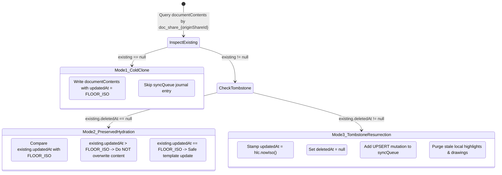

# Phase 16 — Deterministic Explore Clone Identity & Multi-Device Linking

**Status:** Approved Blueprint  
**Target:** Phase 16  
**Related Documents:** `docs/roadmap.md`, `docs/architecture/adr/ADR-018-google-drive-appdata-sync-and-stateless-auth.md`, `src/domain/sync/utils/hlc.ts`

---

## 1. Context & Problem Statement

Curriculum and community study materials are published as `.lcpack` study packages and distributed through the Explore Hub (`/explore`). When a user clicks **Clone to Library**, `ClonePublishedShareUseCase` unpacks the package and persists markdown content, questions, and quizzes into local Dexie storage.

In a multi-device setup synchronized via Bring-Your-Own-Storage (Google Drive `appDataFolder` sync per ADR-018), naive cloning introduces two failure modes:

1. **HLC Inversion (Overwriting User Edits):**
   - User clones course on Device A at 10:00 AM.
   - User adds notes and edits markdown on Device A at 10:15 AM (HLC timestamp `2026-10-16T10:15:00.000Z_0000_device-A`).
   - User clones the *same* course on Device B at 11:00 AM.
   - *Vulnerability:* If Device B stamps fresh clone records with `Date.now()` (11:00 AM), Device B's unmodified template records will possess an HLC newer than Device A's edits. Under Last-Write-Wins (LWW) causal ordering, Device B overwrites Device A's edits during sync.
2. **Identity Fragmentation & Annotation Severing:**
   - If cloning generates random UUIDs (`crypto.randomUUID()`), Device A and Device B assign different primary keys (`id`, `documentId`) to the same material.
   - Highlights, drawing strokes, and spaced-repetition flashcard schedules created on Device A cannot attach to Device B's copy of the course, creating fractured duplicates.

---

## 2. Epoch Floor & Canonical Floor HLC

To prevent template clones from clobbering user progress, all unedited Explore course records are pinned to a deterministic Unix epoch floor timestamp.

### 2.1 Constants

```typescript
/** Fixed physical timestamp for clean Explore template records. */
export const FLOOR_ISO = '1970-01-01T00:00:00.000Z';

/**
 * Deterministic canonical HLC for clean Explore template records.
 * Uses a zero logical counter and synthetic device ID '00000000' to eliminate
 * clock drift and device-ID tiebreak churn across peer devices.
 */
export const CANONICAL_FLOOR_HLC = '1970-01-01T00:00:00.000Z_0000_00000000';
```

### 2.2 Canonical Derivation Contract

In `src/infrastructure/api/google/streamVaultChunksGzipped.ts` and sync transports:

```typescript
export function deriveEntityHlc(timestamp: string | undefined, deviceId: string): string {
  if (!timestamp || timestamp === FLOOR_ISO) {
    return CANONICAL_FLOOR_HLC;
  }
  const d = new Date(timestamp);
  const iso = isNaN(d.getTime()) ? FLOOR_ISO : d.toISOString();
  if (iso === FLOOR_ISO) {
    return CANONICAL_FLOOR_HLC;
  }
  return `${iso}_0000_${deviceId}`;
}
```

### 2.3 Guarantees:
- **Device-ID Tiebreak Invariance:** Standard HLC tiebreaking uses lexicographical comparison of `deviceId`. If Device A stamped `1970-01-01T..._device-A` and Device B stamped `1970-01-01T..._device-B`, `device-B` would win arbitrarily. `CANONICAL_FLOOR_HLC` uses a fixed synthetic device identifier (`00000000`), guaranteeing identical clocks on all devices.
- **Strict Dominance of User Edits:** Any authentic user mutation (`hlc.now()`) occurs at current physical time (2026+), strictly dominating `CANONICAL_FLOOR_HLC` under `compareHlc`.

---

## 3. Deterministic Entity ID Architecture

Study package remapping (`remapStudyPackage`) switches from random UUID generation to deterministic key derivation whenever `originShareId` is present:

| Entity | ID Scheme | Source of Key |
|---|---|---|
| **Material** | `mat_share_${originShareId}` | Share root identifier |
| **Document** | `doc_share_${originShareId}` | Share root identifier (1:1 with material) |
| **Question** | `q_share_${originShareId}_${stableQuestionKey}` | Package-scoped `q.id` (e.g. `pkg_q_1`) |
| **Quiz** | `quiz_share_${originShareId}_${stableQuizKey}` | Package-scoped `quiz.id` (e.g. `pkg_quiz_1`) |

### Key Properties:
- **Stable Question Keys:** Uses the package-scoped `q.id` rather than array indices. Array indices are unstable if packages are updated or reordered by publishers.
- **Relational Integrity:** Embedded asset URIs (`lc-asset://...`), quiz item references (`questionId`), and question material keys (`materialId`) resolve deterministically against these computed keys.
- **Cross-Device Attachment:** Highlights and drawings attach by `documentId` (`doc_share_${originShareId}`); flashcard reviews attach by `q:${questionId}`. Both resolve to identical rows regardless of which device initiated the clone.

---

## 4. Three-Mode Clone State Machine

`ClonePublishedShareUseCase` and `DexieStudyPackageImportService` evaluate local database state before writing to execute one of three explicit transitions:



### 4.1 Mode 1: Cold Clone
- **Trigger:** `existing == null`.
- **Behavior:** Complete fresh import.
- **Timestamps:** `updatedAt = FLOOR_ISO`, `deletedAt = null`.
- **Sync Journal:** Zero outbox entries written (`syncQueue` bypassed).

### 4.2 Mode 2: Preserved Hydration
- **Trigger:** `existing != null && existing.deletedAt == null`.
- **Branch A (`existing.updatedAt > FLOOR_ISO`):** User has edited the course locally or received edits via Google Drive sync.
  - **Action:** Retain existing `documentContents.content` and user markdown verbatim. Do **NOT** overwrite with template text. Hydrate missing questions, quizzes, and assets if not present.
- **Branch B (`existing.updatedAt === FLOOR_ISO`):** Unmodified template.
  - **Action:** Safe to refresh template content and metadata from latest share package. Stamp remains `FLOOR_ISO`. No outbox entry.

### 4.3 Mode 3: Tombstone Resurrection
- **Trigger:** `existing != null && existing.deletedAt != null` (course was previously deleted).
- **Behavior:** Explicit user re-clone of a previously deleted material.
- **Actions:**
  1. Revive document: stamp `updatedAt = hlc.nowIso()` and `deletedAt = null`.
  2. Enqueue sync outbox mutation (`operation: 'UPSERT'`) in `db.syncQueue` within the same transaction to propagate the un-deletion across Drive sync.
  3. Tomb-sweep old annotations: purge stale local `highlights` and `drawings` matching `documentId` so remnants from the prior lifecycle do not bleed into the resurrected material.

---

## 5. Sync Outbox Floor Filter

Explore courses are distributed via Cloudflare D1 shares (`/api/shares`), not user Google Drive storage. Syncing stock template text over Google Drive wastes user cloud quota and generates redundant network traffic.

### 5.1 Outbox Ingestion Guard
When importing in Mode 1 or Mode 2, `DexieStudyPackageImportService` writes directly to Dexie tables without enqueuing entries in `db.syncQueue`.

### 5.2 Dirty Record Collector Filter
In baseline creation (`collectVaultChunksGzipped`) and delta detection (`GoogleDriveSyncTransport.collectLocalDeltas`):

```typescript
// Skip clean Explore templates during sync delta collection
if (doc.updatedAt === FLOOR_ISO && !doc.deletedAt) {
  continue;
}
```

- Unmodified templates remain strictly local-first.
- User modifications bump `updatedAt` to `hlc.nowIso()`, immediately qualifying the document for sync collection.
- Deletions set `deletedAt = hlc.nowIso()`, qualifying tombstones for sync propagation.

---

## 6. Course Deletion Cascade & Multi-Device Tombstoning

In a multi-device LWW synchronization model, deleting records locally without tombstones causes peer devices or remote vault baselines to resurrect deleted items on subsequent pulls.

### 6.1 Extended `removeMaterial` Transaction
`DexieLibraryImportService.removeMaterial` executes inside a single `db.transaction('rw', [...])` across:
`materials`, `documentContents`, `questions`, `quizzes`, `localAssets`, `collectionMaterials`, `highlights`, `drawings`, `flashcardReviews`, `syncQueue`.

### 6.2 Cascade Contracts:
1. **Document Tombstone:** If `material.documentId` exists:
   - Soft-delete `documentContents`: stamp `deletedAt = hlc.nowIso()` and `updatedAt = hlc.nowIso()`.
   - Enqueue outbox `DELETE` mutation in `db.syncQueue`.
2. **Annotation Tombstones:**
   - Query `highlights` and `drawings` matching `documentId`.
   - Enqueue outbox `DELETE` mutations with `deletedAt = hlc.nowIso()`.
   - Delete local rows from `highlights` and `drawings`.
3. **Flashcard Schedules:**
   - Delegate to `DexieFlashcardReviewRepository.deleteByKeys` (enqueues tombstones for all question review keys).
4. **Local Binary Assets & Junctions:**
   - Hard-delete from `localAssets` and `collectionMaterials` (device-local, non-synced stores).
5. **Local Entity Clean:**
   - Hard-delete matching rows from `materials`, `questions`, and `quizzes`.

---

## 7. Implementation Roadmap & Touch Points

```
src/
  domain/
    sync/utils/hlc.ts                    <- Export FLOOR_ISO and CANONICAL_FLOOR_HLC
    package/engines/remapStudyPackage.ts <- Deterministic ID generation based on originShareId
  infrastructure/
    api/google/
      streamVaultChunksGzipped.ts        <- deriveEntityHlc floor normalization + collector filter
    api/transports/
      GoogleDriveSyncTransport.ts        <- deriveEntityHlc floor normalization + delta filter
    database/services/
      DexieStudyPackageImportService.ts  <- Three-mode clone state machine
      DexieLibraryImportService.ts       <- Extended deletion cascade with tombstones
```

### Step 1: Core HLC & Timestamp Primitives
- Add `FLOOR_ISO` and `CANONICAL_FLOOR_HLC` in `src/domain/sync/utils/hlc.ts`.
- Update `deriveEntityHlc` across Google sync pipelines to normalize `FLOOR_ISO` to `CANONICAL_FLOOR_HLC`.

### Step 2: Deterministic Remapper
- Enhance `remapStudyPackage(pkg, idGenerator, originShareId)`.
- Use `originShareId` to generate `mat_share_${originShareId}`, `doc_share_${originShareId}`, `q_share_${originShareId}_${q.id}`, `quiz_share_${originShareId}_${quiz.id}`.

### Step 3: State Machine in Importer Service
- Implement Mode 1, Mode 2, and Mode 3 branches in `DexieStudyPackageImportService`.
- Guard `documentContents` overwriting when `existing.updatedAt > FLOOR_ISO`.
- Handle resurrection and annotation sweep for tombstoned documents.

### Step 4: Sync Outbox & Delta Filtering
- Verify no `syncQueue` entries emitted on initial Explore clone.
- Add `updatedAt === FLOOR_ISO && !deletedAt` guard in `streamVaultChunksGzipped.ts` and `GoogleDriveSyncTransport.ts`.

### Step 5: Deletion Cascade & Tombstoning
- Extend `DexieLibraryImportService.removeMaterial` to tombstone documents, highlights, and drawings before local table deletions.

---

## 8. Verification & Acceptance Criteria

1. **Unit Tests:**
   - `hlc.test.ts`: Verify `deriveEntityHlc(FLOOR_ISO)` returns `CANONICAL_FLOOR_HLC`.
   - `compareHlc`: Verify any `hlc.now()` timestamp strictly dominates `CANONICAL_FLOOR_HLC`.
   - `remapStudyPackage.test.ts`: Verify deterministic ID output when `originShareId` is supplied.
2. **Integration Tests (`DexieStudyPackageImportService.test.ts`):**
   - Mode 1: Clean clone sets `updatedAt = FLOOR_ISO` and leaves `syncQueue` empty.
   - Mode 2: Re-cloning course with local modifications (`updatedAt > FLOOR_ISO`) preserves user markdown.
   - Mode 3: Re-cloning tombstoned course clears `deletedAt`, sets `updatedAt = hlc.nowIso()`, and adds outbox entry.
3. **Sync Integration Tests (`GoogleDriveSyncTransport.test.ts`):**
   - Verify unedited Explore courses produce zero delta mutations during baseline seeding and push passes.
4. **Multi-Device E2E Scenario:**
   - Device A clones Course X and adds a note.
   - Device B clones Course X.
   - Both devices sync via Google Drive.
   - *Pass Condition:* Device B receives Device A's notes; Device A's notes are never overwritten.
